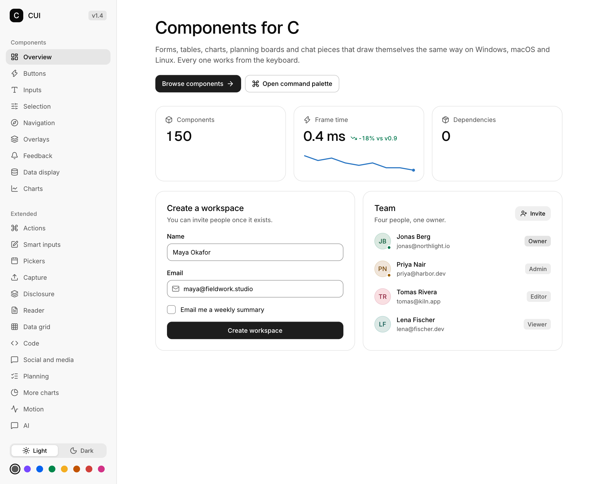
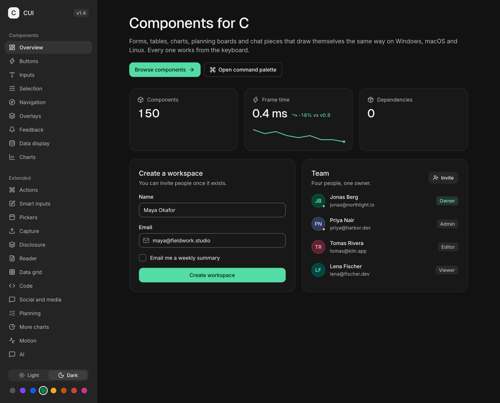

# Theming

CUI ships one carefully tuned look in two modes and eight accents. Most apps never need more than that, but every value is open to change.

## Light, dark and accents

```c
cui_set_theme(ui, CUI_THEME_DARK);          /* or CUI_THEME_LIGHT */
cui_set_accent(ui, CUI_ACCENT_BLUE);        /* NEUTRAL, VIOLET, BLUE, GREEN, AMBER, ORANGE, CORAL, ROSE */
```

Both changes animate: every color blends over about 300 ms in OKLab, so the whole interface fades from one theme to the other instead of flashing. You can also pick them up front:

```c
cui_app_create(&(cui_app_desc){ .theme = CUI_THEME_DARK, .accent = CUI_ACCENT_GREEN });
cui_app_create(&(cui_app_desc){ .follow_system_theme = true });   /* Windows and macOS */
```

A theme switcher with Light, Dark and System changes this while the app runs. `cui_app_follow_system_theme(NULL, false)` stops following, so the `cui_set_theme` you call next lasts; `cui_app_follow_system_theme(NULL, true)` applies the system's setting at once and follows it again. `NULL` is the running app, as in a `cui_app_run` callback.

| Neutral, light | Green, dark |
|---|---|
|  |  |

The neutral accent is near black in light mode and near white in dark mode. The colored accents are tuned per mode so text and controls keep their contrast.

## Semantic colors

Components never use raw colors. They use tokens, and so should your own boxes and text, so they follow the theme:

| Role | Tokens |
|---|---|
| Page and surfaces | `CUI_COLOR_BACKGROUND`, `SURFACE`, `SURFACE_RAISED`, `SURFACE_MUTED` |
| Text | `CUI_COLOR_FOREGROUND`, `TEXT_SECONDARY`, `TEXT_MUTED` |
| Lines | `CUI_COLOR_BORDER`, `BORDER_SUBTLE`, `BORDER_STRONG` |
| Accent | `CUI_COLOR_ACCENT`, `ACCENT_STRONG`, `ACCENT_SUBTLE`, `ACCENT_FOREGROUND` |
| Status | `CUI_COLOR_SUCCESS`, `WARNING`, `DANGER`, `INFO` |
| Interaction | `CUI_COLOR_HOVER`, `CUI_COLOR_SCRIM` |
| Charts | `CUI_COLOR_SERIES(0..5)` |

```c
cui_box(ui, .bg = CUI_COLOR_SURFACE_MUTED, .border = 1, .radius = 12, .pad = 16) {
    cui_text(ui, "Muted panel", .color = CUI_COLOR_TEXT_SECONDARY);
}
```

Tokens are ordinary `cui_color` values with a marker, so they work anywhere a color does. To get the concrete color, call `cui_color_of(ui, CUI_COLOR_ACCENT)` or `cui_token_color(ui, CUI_TOKEN_ACCENT)`.

The six series colors (blue, orange, aqua, violet, yellow and magenta, rotated so the first sits nearest the accent hue) share one lightness in each mode, so no series is louder than another; their order keeps neighbours apart under color blindness.

Spend the accent with intent: the selected item, the one series that matters, progress, focus. Status colors are for status only, always paired with a label or an icon.

## Customizing

`cui_theme_get` returns the live theme. Change what you like; it applies on the next frame.

```c
cui_theme *t = cui_theme_get(ui);
t->radius_control = 18;          /* pill shaped buttons and inputs (default 10) */
t->radius_panel = 20;            /* menus, popovers (14) */
t->radius_surface = 26;          /* cards, dialogs (18) */
t->control_md = 32;              /* denser controls (36) */
t->text_body = 14;               /* body text size (13) */
t->font_scale = 1.1f;            /* scale all text */
t->colors[CUI_TOKEN_ACCENT] = cui_oklch(0.62f, 0.19f, 145, 1);   /* your brand color */
```

`cui_set_theme` and `cui_set_accent` rebuild the colors but keep your radii, motion and font scale. To build a theme from scratch, fill all of `colors`.

Color helpers work in OKLab, like CSS `color-mix(in oklab)`:

```c
cui_color brand = cui_oklch(0.58f, 0.16f, 265, 1);     /* lightness 0..1, chroma, hue in degrees, alpha */
cui_color hover = cui_mix(brand, CUI_RGB(0xffffff), 0.12f);
cui_color faint = cui_alpha(brand, 0.15f);
cui_color hex   = CUI_RGB(0x7747ff);
```

## Typography

| Role | Font | Used for |
|---|---|---|
| `CUI_FONT_BODY` | Inter Regular | Body text, controls |
| `CUI_FONT_MEDIUM` | Inter Medium | Labels, buttons, headings under 28 pt |
| `CUI_FONT_DISPLAY` | Geist Medium | Headings from 28 pt, big numbers |
| `CUI_FONT_MONO` | Geist Mono | Code |
| `CUI_FONT_ICONS` | Lucide | Icons |

The embedded fonts cover Latin, Latin-1 and Latin Extended-A plus common symbols. Replace a role or add fallbacks for other scripts:

```c
cui_font brand = cui_font_load_file(ui, "fonts/MyBrand-Regular.ttf");
cui_font_set_role(ui, CUI_FONT_BODY, brand);

cui_font cjk = cui_font_load_file(ui, "fonts/NotoSansCJK-Regular.otf");
cui_font_add_fallback(ui, CUI_FONT_BODY, cjk);      /* missing glyphs come from here */
cui_font_add_fallback(ui, CUI_FONT_MEDIUM, cjk);
```

Text is rasterized with subpixel positioning and kerning at the exact pixel size of the display, so it stays crisp at 100%, 150% and 200%.

## Motion

Animations are springs. Values that report state (a switch thumb, a progress bar, a panel height) land without overshoot. Small feedback (presses, highlights) gets a little life. Exits are faster than entrances.

```c
cui_set_reduced_motion(ui, true);    /* snap to final states; keep feedback */
cui_theme_get(ui)->motion = 2.0f;    /* slow motion, handy when designing */
```

Respect your users' system setting by passing it in at startup.

## Shadows

Only floating layers (menus, popovers, dialogs, toasts) cast shadows. Cards rest on a border. The three elevations come from the theme and are tuned separately for light and dark:

```c
cui_box(ui, .elevation = CUI_ELEVATION_RAISED, .bg = CUI_COLOR_SURFACE_RAISED, .radius = 16) { ... }
t->shadow_floating[0] = (cui_shadow){ .y = 24, .blur = 60, .alpha = 0.14f };
```
